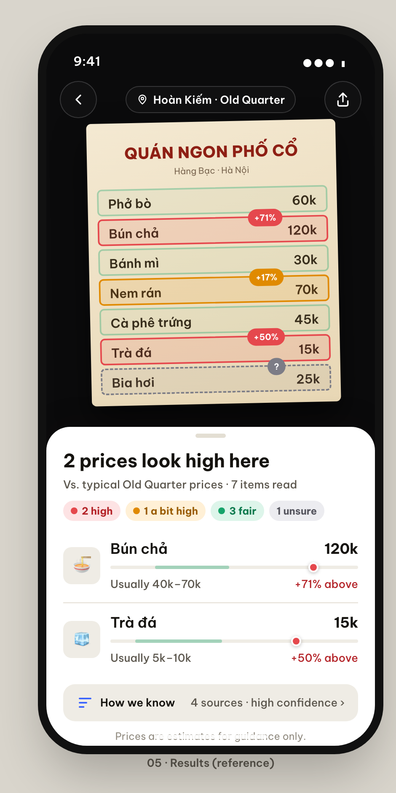

# Hanoi Fair Price (Chợ Price Lens)

Point your phone at a menu, or type what the seller told you, and find out in seconds whether a street price in Hanoi's Old Quarter (Phố cổ) is fair, what locals typically pay, and where it is cheaper nearby.

Built for tourists and locals alike.



## Features

- **Scan a menu**: take a photo or use the live camera view; the app reads the items and prices (Gemini vision + optional Google Cloud Vision OCR).
- **Quick quote**: type or say an item and the price you were quoted.
- **Fair-price verdict**: compares against reference prices and explains the result.
- **Nearby alternatives**: uses Google Maps to suggest cheaper places around you.
- **"What did you pay?"**: check a price after the fact.
- **Price history** stored locally in your browser.

## Tech stack

React 19, Vite, Tailwind CSS 4, Express (TypeScript via `tsx`), Google Gemini (`@google/genai`), Google Maps, OpenCV.js and MediaPipe for on-device menu detection.

## Getting started

Requires Node.js 20+.

```bash
npm install
cp .env.example .env   # then fill in your keys
npm run dev
```

Open http://localhost:3000.

### Environment variables

| Variable | Required | Purpose |
| --- | --- | --- |
| `GEMINI_API_KEY` | Yes | Menu scanning, explanations, neighbourhood context. Get one at [Google AI Studio](https://aistudio.google.com/apikey). |
| `GOOGLE_CLOUD_VISION_API_KEY` | No | Extra OCR pass for menu text. |
| `GOOGLE_MAPS_API_KEY` | No | Nearby places and map view. |
| `GOOGLE_MAPS_MAP_ID` | No | Styled map. |

API keys stay on the server; never commit your `.env` file.

## Scripts

| Command | What it does |
| --- | --- |
| `npm run dev` | Start the dev server (Express + Vite) |
| `npm run build` | Production build |
| `npm start` | Run the server |
| `npm test` | Run unit tests |
| `npm run lint` | Type-check with `tsc` |

## Project layout

```
server.ts        Express server and /api routes (Gemini, Maps)
src/agent/       Perceive → normalize → lookup → judge → respond pipeline
src/components/  Mobile UI screens and sheets
src/site/        Landing page, guide and desktop layout
src/lib/         Price parsing, units, menu detection, storage
src/data/        Reference prices and sample data
```

## Disclaimer

Price verdicts are estimates based on reference data and AI interpretation. Use them as a guide, not a guarantee.
